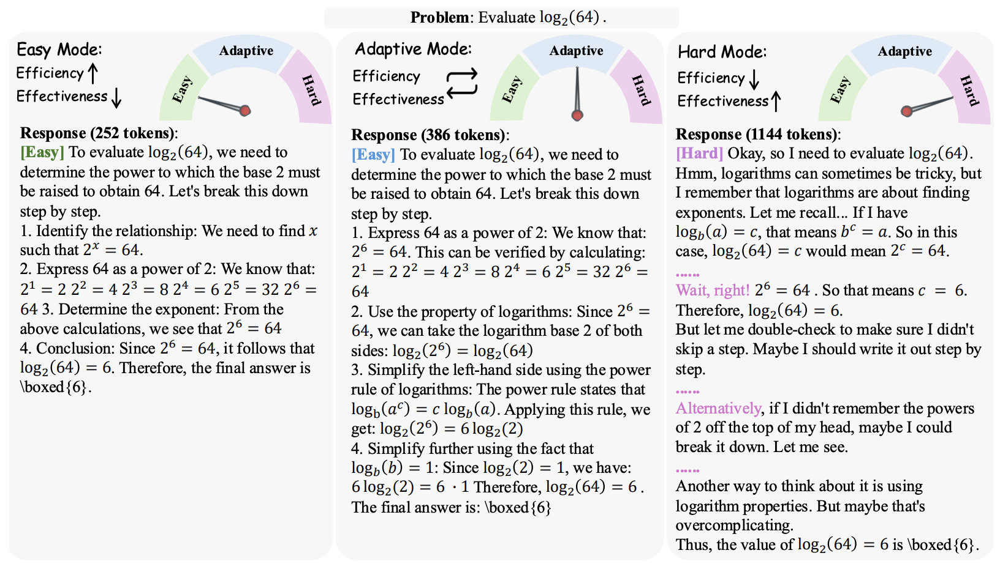
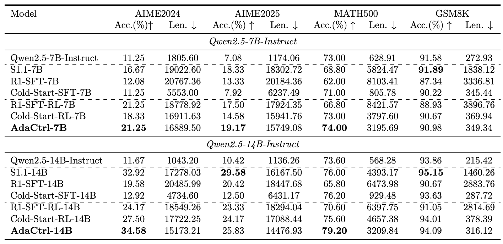
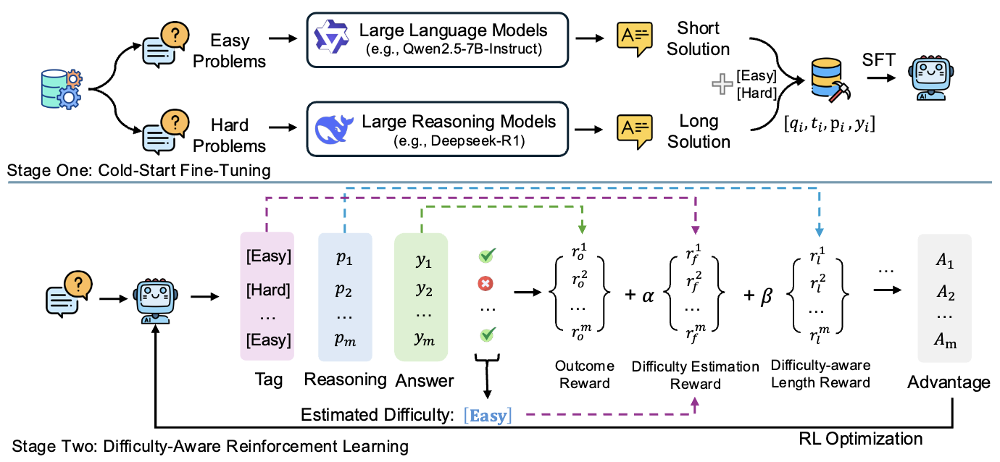

<div align="center">

  <h1 style="margin: 0; font-size: 2.0em;">
    🎛️ AdaCtrl: Towards Adaptive and Controllable Reasoning <br> via Difficulty-Aware Budgeting
  </h1>

  <p>
    <b>A Unified Framework for Dynamic Reasoning Budget Allocation and Explicit User Control</b>
  </p>

  <a href="https://arxiv.org/abs/2505.18822">
    
  </a>
  <a href="https://github.com/volcengine/verl">
    
  </a>
  <a href="https://www.apache.org/licenses/">
    
  </a>
  <a href="https://www.python.org/">
    
  </a>

</div>

---

## 📖 Introduction

Large Language Models (LLMs) often suffer from a computational mismatch: they tend to "overthink" simple problems (wasting inference budget) or "underthink" complex ones (sacrificing accuracy). Current methods either uniformly minimize tokens or rely on brittle, fine-grained prompt constraints.

To address this, we introduce **AdaCtrl**, a novel framework that empowers models to:
1.  **Adaptively** adjust reasoning length based on self-assessed problem difficulty (**Adaptive Mode**).
2.  **Controllably** allow users to specify the desired reasoning effort via explicit tags (**[Easy]** vs **[Hard]**).

AdaCtrl effectively balances performance and computational efficiency, leading to performance improvements while dynamically reducing response lengths by up to **90%**.

<div align="center">
  
  <br>
</div>

---

## 📊 Highlights & Results

AdaCtrl demonstrates superior trade-offs between accuracy and token usage across four benchmarks (**AIME2024**, **AIME2025**, **MATH500**, **GSM8K**).

*   **📈 Performance:** Achieves accuracy improvements of up to **10.14%** compared to standard SFT+RL baselines.
*   **⚡ Efficiency:** Reduces response length by up to **91.04%** on simpler datasets like GSM8K.
*   **🎮 Controllability:** Users can explicitly steer the efficiency-effectiveness trade-off using difficulty tags.

<div align="center">
  
</div>

> *More detailed results and baselines can be found in our paper.*

---

## 🍭 Method Pipeline

AdaCtrl utilizes a carefully designed **two-stage training pipeline** to instill difficulty awareness:

<div align="center">
  
</div>


### Stage 1: Cold-Start Fine-Tuning
We construct a dataset covering both easy and hard subsets (derived from DeepMATH).
*   **Easy Problems:** Trained on concise responses (Instruction Model traces).
*   **Hard Problems:** Trained on long reasoning trajectories (DeepSeek-R1 traces).
*   **Tagging:** We prepend explicit difficulty tags (`[Easy]` or `[Hard]`) to the responses, teaching the model basic budget awareness.

### Stage 2: Difficulty-Aware Reinforcement Learning
We employ **Group Relative Policy Optimization (GRPO)** with a trio of rewards to calibrate the model's self-assessment and refine its policy:

1.  **Outcome Accuracy Reward ($r_o$):** Verifies the correctness of the final answer.
2.  **Difficulty Estimation Calibration Reward ($r_f$):** Aligns the generated difficulty tag with the "ground truth" difficulty estimated from multiple rollouts.
3.  **Difficulty-Aware Length Reward ($r_l$):** Encourages conciseness *only* when the model predicts `[Easy]`, preventing over-optimization on hard problems.

$$ r(y_i) = r_o(y_i) + \alpha \cdot r_f(y_i) + \beta \cdot r_l(y_i) $$

---

## 🛠️ Installation

Our environment is built on top of [Verl](https://github.com/volcengine/verl).

```bash
pip3 install ray[default]
pip3 install torch==2.5.1 torchvision==0.20.1 torchaudio==2.5.1 --index-url https://download.pytorch.org/whl/cu124
pip3 install flash-attn==2.7.4.post1 --no-build-isolation
pip3 install omegaconf==2.4.0.dev3 hydra-core==1.4.0.dev1 antlr4-python3-runtime==4.11.0 vllm==0.7.3
pip3 install math-verify[antlr4_11_0]==0.7.0 fire deepspeed tensorboardX prettytable datasets transformers==4.49.0
pip3 install -e verl
```

#### Training

Start ray and run the following scripts to train 7B or 14B models:

```
set -e
set -u
export VLLM_ATTENTION_BACKEND=XFORMERS
export HYDRA_FULL_ERROR=1

NNODES=4
RUN_NAME=Qwen2.5-7B-Instruct-AdaCtrl
model=/../../xxx_7B
train_path=train.parquet
test_path=test.parquet

mkdir -p logs/$RUN_NAME

PYTHONUNBUFFERED=1 python3 -m verl.trainer.main_ppo \
    data.train_files=$train_path \
    data.val_files=$test_path \
    data.prompt_key=prompt \
    data.truncation='left' \
    data.train_batch_size=256 \
    data.gen_batch_size=512 \
    data.max_prompt_length=2048 \
    data.max_response_length=24576 \
    algorithm.adv_estimator=grpo \
    algorithm.kl_ctrl.kl_coef=0.0 \
    algorithm.filter_groups.enable=True \
    algorithm.filter_groups.max_num_gen_batches=10 \
    algorithm.filter_groups.metric=acc \
    actor_rollout_ref.model.path=$model \
    actor_rollout_ref.model.use_remove_padding=True \
    actor_rollout_ref.model.enable_gradient_checkpointing=True \
    +actor_rollout_ref.model.override_config.attention_dropout=0. \
    +actor_rollout_ref.model.override_config.embd_pdrop=0. \
    +actor_rollout_ref.model.override_config.resid_pdrop=0. \
    actor_rollout_ref.actor.optim.lr=1e-6 \
    actor_rollout_ref.actor.optim.lr_warmup_steps=10 \
    actor_rollout_ref.actor.optim.weight_decay=0.1 \
    actor_rollout_ref.actor.ppo_mini_batch_size=32 \
    actor_rollout_ref.actor.use_dynamic_bsz=True \
    actor_rollout_ref.actor.ppo_max_token_len_per_gpu=32768 \
    actor_rollout_ref.actor.use_kl_loss=False \
    actor_rollout_ref.actor.kl_loss_coef=0.0 \
    actor_rollout_ref.actor.entropy_coeff=0.0 \
    actor_rollout_ref.actor.grad_clip=1.0 \
    actor_rollout_ref.actor.fsdp_config.param_offload=False \
    actor_rollout_ref.actor.fsdp_config.optimizer_offload=False \
    actor_rollout_ref.actor.clip_ratio_low=0.2 \
    actor_rollout_ref.actor.clip_ratio_high=0.28 \
    actor_rollout_ref.actor.use_token_level_loss=True \
    actor_rollout_ref.actor.ulysses_sequence_parallel_size=2 \
    actor_rollout_ref.actor.fsdp_config.fsdp_size=-1 \
    actor_rollout_ref.rollout.log_prob_use_dynamic_bsz=True \
    actor_rollout_ref.rollout.log_prob_max_token_len_per_gpu=131072 \
    actor_rollout_ref.rollout.temperature=1.0 \
    actor_rollout_ref.rollout.top_p=1.0 \
    actor_rollout_ref.rollout.n=16 \
    actor_rollout_ref.rollout.val_kwargs.temperature=0.7 \
    actor_rollout_ref.rollout.val_kwargs.top_p=0.8 \
    actor_rollout_ref.rollout.val_kwargs.do_sample=True \
    actor_rollout_ref.rollout.val_kwargs.n=1 \
    actor_rollout_ref.rollout.tensor_model_parallel_size=4 \
    actor_rollout_ref.rollout.gpu_memory_utilization=0.8 \
    actor_rollout_ref.rollout.enable_chunked_prefill=True \
    actor_rollout_ref.rollout.max_num_batched_tokens=32768 \
    actor_rollout_ref.rollout.disable_log_stats=False \
    actor_rollout_ref.rollout.enforce_eager=True \
    actor_rollout_ref.ref.log_prob_use_dynamic_bsz=True \
    actor_rollout_ref.ref.log_prob_max_token_len_per_gpu=131072 \
    actor_rollout_ref.ref.fsdp_config.param_offload=False \
    custom_reward_function.path=/utils/reward_utils/reward_func.py \
    custom_reward_function.name=reward_func \
    custom_reward_function.overlong_buffer.enable=True \
    custom_reward_function.overlong_buffer.len=4096 \
    custom_reward_function.overlong_buffer.log=True \
    custom_reward_function.overlong_buffer.penalty_factor=1.0 \
    reward_model.diff_format=True \
    reward_model.diff_format_weight=0.5 \
    reward_model.diff_len=True \
    reward_model.diff_len_weight=0.5 \
    reward_model.diff_threshold=0.625 \
    trainer.project_name=adactrl \
    trainer.experiment_name=$RUN_NAME \
    trainer.run_id=$RUN_NAME \
    trainer.default_local_dir=ckpt/$RUN_NAME \
    trainer.logger=['console','wandb'] \
    +trainer.val_before_train=True \
    trainer.n_gpus_per_node=8 \
    trainer.nnodes=$NNODES \
    trainer.save_freq=5 \
    trainer.save_rollout=True \
    trainer.test_freq=5 \
    trainer.total_epochs=5000 \
    trainer.total_training_steps=5000 2>&1 | tee -a logs/$RUN_NAME/train.log


```

or run:

```
bash train.sh
```

## 🙏 Acknowledgements

This work is inspired and supported by the following amazing works:

- [verl](https://github.com/volcengine/verl): A very fast reinforcement learning framework.
- [DeepMath](https://github.com/zwhe99/DeepMath): A Good Mathematical Dataset for Advancing Reasoning.

## 📖 Citation

If you find this repository helpful, please consider citing our paper:

```
@misc{huang2025adactrladaptivecontrollablereasoning,
      title={AdaCtrl: Towards Adaptive and Controllable Reasoning via Difficulty-Aware Budgeting}, 
      author={Shijue Huang and Hongru Wang and Wanjun Zhong and Zhaochen Su and Jiazhan Feng and Bowen Cao and Yi R. Fung},
      year={2025},
      eprint={2505.18822},
      archivePrefix={arXiv},
      primaryClass={cs.AI},
      url={https://arxiv.org/abs/2505.18822}, 
}
```
